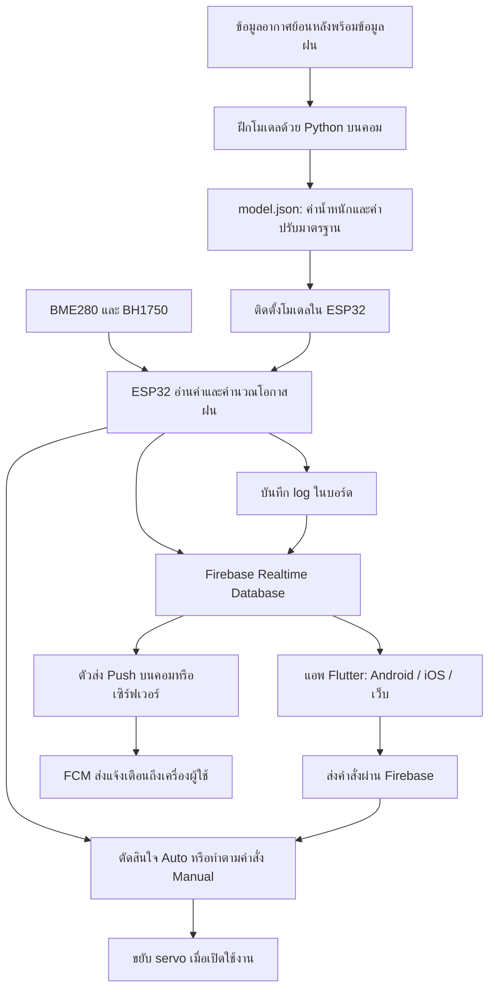

# ทำความเข้าใจ NimbusRail ตั้งแต่ต้นจนใช้งาน

เอกสารนี้สรุปจากโค้ดและรายงานที่อยู่ในโปรเจกต์ ณ **9 ตุลาคม 2026** สำหรับทำความเข้าใจว่าแต่ละส่วนทำอะไร ทำงานร่วมกันอย่างไร และต้องทำอะไรจึงจะใช้งานได้ ไม่ได้มีการอัปโหลดบอร์ด เปลี่ยนโมเดล หรือทดสอบฮาร์ดแวร์ใหม่ในการเขียนเอกสารนี้

## อ่านตรงไหนก่อน

- อยากเห็นภาพรวม: อ่านข้อ 1–3
- สงสัยเรื่องทำนายฝนและเอาโมเดลเข้าบอร์ด: อ่านข้อ 4–7
- อยากเข้าใจ Firebase, แอพ และ Push: อ่านข้อ 8–10
- อยากเริ่มใช้งาน/ทดสอบ: อ่านข้อ 11–13
- อยากหาไฟล์แก้โค้ดและดูงานที่ยังเหลือ: อ่านข้อ 14–16

## 1. งานนี้สร้างขึ้นเพื่ออะไร

**NimbusRail เป็นระบบต้นแบบที่วัดสภาพอากาศบริเวณที่ติดตั้ง ประเมินโอกาสฝนตก และใช้ผลนั้นช่วยตัดสินใจเก็บ/กางราว พร้อมดูข้อมูลและสั่งงานจากมือถือหรือเว็บ**

ส่วนขับเคลื่อนในโค้ดปัจจุบันใช้ servo แบบกำหนดมุมเพื่อสาธิตการเก็บ/กาง ไม่มีเซ็นเซอร์วัดตำแหน่งราวจริง ชุดที่กำลังทดสอบใช้ ESP32 + BME280 + BH1750 ต่อตรง และเลือกเฟิร์มแวร์ปิด servo ไว้ก่อน

| ส่วน | หน้าที่แบบเข้าใจง่าย | อยู่ที่ไหน |
| --- | --- | --- |
| ฮาร์ดแวร์ | วัดอากาศและขยับ servo เมื่อเปิดใช้งาน | ESP32 และอุปกรณ์ที่ต่อสาย |
| Firmware | โปรแกรมประจำบอร์ด อ่านค่า คำนวณ ตัดสินใจ บันทึก และสื่อสาร | `src/`, `include/` |
| โปรแกรมฝึกโมเดล | เรียนรู้ความสัมพันธ์ระหว่างอากาศกับฝนจากข้อมูลย้อนหลัง | Python ใน `training/` รันบนคอม |
| ไฟล์โมเดล | ตัวเลขที่โปรแกรมฝึกเรียนรู้ไว้ ใช้คำนวณผลใหม่ได้ | `model.json` |
| Firebase | ตรวจบัญชี เก็บสถานะ/ประวัติ และรับส่งคำสั่ง | โปรเจกต์ `nimbusrail` บนคลาวด์ |
| แอพ | หน้าจอที่ผู้ใช้ดูข้อมูลและกดควบคุม | Flutter ใน `mobile/` |
| ตัวส่ง Push | อ่านเหตุการณ์ฝนแล้วขอให้ FCM ส่งแจ้งเตือนไปเครื่องผู้ใช้ | Node.js ใน `firebase/push-sender/` |

**Firmware, โมเดล และแอพเป็นคนละอย่าง** อัปโหลด firmware คือเอาโปรแกรมเข้าบอร์ด ติดตั้งโมเดลคือเอาชุดตัวเลขสำหรับคำนวณเข้าบอร์ด ส่วน build แอพคือสร้างโปรแกรมที่ผู้ใช้เปิดบนมือถือ/เว็บ

## 2. ภาพรวมสองช่วง: เตรียมระบบ กับใช้งานจริง



ตอนใช้งานจริง ESP32 อ่านเซ็นเซอร์แล้วคำนวณเอง ไม่ต้องเปิด Python ฝึกโมเดลทิ้งไว้ และ Firebase ไม่ได้เป็นผู้คำนวณโอกาสฝนในระบบนี้ ส่วนคอมที่รันตัวส่ง Push ต้องเปิดไว้หากต้องการ Push ต่อเนื่อง

## 3. Firmware ทำอะไรตั้งแต่เปิดบอร์ด

จุดเริ่มอยู่ที่ [src/main.cpp](../src/main.cpp)

1. เปิด Serial ที่ 115200 baud เพื่อแสดงผลและรับคำสั่งจากคอม
2. โหลดค่าตั้งที่บันทึกไว้ใน NVS และเตรียมส่วน servo ตาม environment ที่เลือก
3. เปิด LittleFS เพื่ออ่าน/เก็บ log และโหลดโมเดล
4. เริ่ม I2C และค้นหา BME280/BH1750
5. เริ่ม Wi-Fi, เวลา NTP และส่วนสื่อสาร Firebase
6. วัดค่ารอบแรกทันที จากนั้นวัดตามรอบเริ่มต้นทุก 30 นาที หรือเมื่อสั่ง `MEASURE`
7. วนดูแลการวัด การคำนวณ เครือข่าย servo และคำสั่งให้ทำงานร่วมกัน

### หนึ่งรอบวัดเกิดอะไรขึ้น

`measureStart → sensorsTick → predictionStart/predictionTick → decide → logAppend → publishStatus`

| ขั้น | สิ่งที่เกิดขึ้น |
| --- | --- |
| อ่านเซ็นเซอร์ | BME280 ให้ °C, %RH, hPa; BH1750 ให้ lux |
| ตรวจค่า | ต้องได้ค่าครบทั้งสี่ชนิด อยู่ในช่วงที่กำหนด และเป็นตัวเลข |
| ลดความแกว่ง | เก็บค่าที่ผ่าน 3 ครั้งจากการลองไม่เกิน 6 ครั้ง แล้วเฉลี่ย; กำหนดช่วงอ่านประมาณ 200 ms |
| ทำนาย | เปลี่ยนผลวัดเป็นอินพุตโมเดล แล้วคำนวณ `p_rain` ช่วง 0–1 |
| ตัดสินใจ | ถ้าอยู่ Auto และตำแหน่งพร้อม ตรวจเกณฑ์เก็บ/กางราว |
| บันทึก | เก็บผลวัด ผลทำนาย สถานะ และธงผิดพลาดลง log |
| เผยแพร่ | แสดงสถานะทาง Serial และให้ส่วน Firebase นำข้อมูลไปซิงก์ |

หากเซ็นเซอร์ตัวใดตัวหนึ่งทำให้ได้ค่าครบไม่ถึง 3 ครั้ง รอบนั้นจะเป็น `sensor_err=true` ทั้งชุด จึงอาจเห็นทุกช่องเป็น `—` แม้เซ็นเซอร์อีกตัวจะยังตอบสนองอยู่

### เวลาสี่อย่างที่อย่าสับสน

| เวลา | ความหมาย |
| --- | --- |
| ทุก 30 นาที | รอบวัดและทำนายอัตโนมัติเริ่มต้น |
| ล่วงหน้า 2 ชั่วโมง | เป้าหมายฝนที่โมเดลปัจจุบันถูกฝึกให้ประเมิน |
| ประมาณ 10 วินาทีหลังคำขอก่อนหน้าจบ | รอบซิงก์ Firebase ไม่ใช่รอบวัดใหม่ |
| 30 วินาที / 5 นาที | แอพตรวจอายุสถานะออนไลน์ / อายุผลวัดแยกกัน |

ดังนั้นบอร์ดอาจยังออนไลน์ แต่ผลวัดเก่ากว่า 5 นาทีจนหน้าแอพขึ้นว่ายังประเมินไม่ได้ ทั้งที่รอบวัดถัดไปยังมาไม่ถึง กดวัดค่าใหม่เพื่อดูผลสดได้ นี่คือพฤติกรรมของค่าตั้งปัจจุบัน

## 4. ทำนายฝนอย่างไร

### 4.1 ฝึกโมเดลบนคอม

[training/train.py](../training/train.py) ใช้ Logistic Regression เรียนรู้จากข้อมูลอากาศย้อนหลัง โดยแยกสองส่วน:

- **อินพุต:** สภาพอากาศที่ทราบแล้ว เช่น อุณหภูมิ ความชื้น ความกดอากาศ และแสง
- **คำตอบสำหรับฝึก:** มีฝนถึงเกณฑ์ในช่วงอนาคตหรือไม่ ตามข้อมูลย้อนหลังที่มีคำตอบอยู่แล้ว

โมเดลที่แนบตั้ง `horizon_h=2` และ `rain_mm=0.1` โค้ดติดป้ายว่าเป็นฝนเมื่อข้อมูลฝนรายชั่วโมงอย่างน้อยหนึ่งจุดใน 2 ชั่วโมงถัดไปถึงเกณฑ์ 0.1 mm ไม่ได้ทำนายปริมาณฝนทั้งหมด เวลาฝนเริ่มแบบนาทีต่อนาที หรือรับประกันว่าจะตกแน่นอน

ข้อมูลฝึกต้องมีคอลัมน์ `time`, `temperature_2m`, `relative_humidity_2m`, `surface_pressure`, `shortwave_radiation`, `precipitation` และเวลาเรียงต่อเนื่องรายชั่วโมง โปรแกรมประมาณ lux จาก `shortwave_radiation × 120` จึงยังต้องเทียบกับค่าจาก BH1750 ณ จุดติดตั้ง

### 4.2 โมเดลปัจจุบันใช้ค่าอะไร

ไฟล์ [firmware_data/model.json](../firmware_data/model.json) ตรงกับ [training/model.json](../training/model.json) ในวันที่ตรวจ มีเวอร์ชัน `snapshot-20261006200131` และ `input_mode="current"`

ใช้ข้อมูลปัจจุบัน 6 ค่า:

| อินพุต | มาจากไหน |
| --- | --- |
| `temp` | อุณหภูมิจาก BME280 |
| `hum` | ความชื้นจาก BME280 |
| `press` | ความกดอากาศจาก BME280 |
| `lux_log` | แปลงแสง BH1750 ด้วย `log10(1 + lux)` |
| `dew_point` | จุดน้ำค้าง คำนวณจากอุณหภูมิและความชื้น |
| `temp_minus_dew` | อุณหภูมิลบจุดน้ำค้าง |

รูปแบบไฟล์ยังมีช่องอินพุต 16 ค่าเพื่อใช้ร่วมกับโมเดลรุ่น history แต่ 10 ช่องที่เหลือมีน้ำหนักเป็นศูนย์ในรุ่น current ดังนั้นรุ่นนี้ไม่ต้องรอสะสมประวัติ 3 ชั่วโมง และไม่ต้องมีเวลาจริงเพื่อคำนวณโมเดล

อย่างไรก็ตาม **การซิงก์ Firebase ยังรอเวลา NTP** เพื่อการเชื่อมต่อและจัดการคำสั่ง/เวลาเหตุการณ์ การทำนายในบอร์ดกับการซิงก์คลาวด์มีเงื่อนไขต่างกัน

### 4.3 ESP32 คำนวณอย่างไร

สูตรอยู่ใน [include/features.h](../include/features.h) และการเลือกใช้โมเดลอยู่ใน [src/predictor.cpp](../src/predictor.cpp)

```text
ค่าปรับมาตรฐานแต่ละตัว = (ค่าที่วัดหรือคำนวณได้ - mean) / scale
คะแนนรวม z = intercept + ผลรวม(coef × ค่าปรับมาตรฐาน)
p_rain = 1 / (1 + exp(-z))
เปอร์เซ็นต์ที่แอพแสดง = p_rain × 100
```

ความหมายของตัวเลขใน JSON:

| ชื่อ | ความหมาย |
| --- | --- |
| `features` | ชื่อและลำดับอินพุต ต้องตรงกับสูตรใน firmware |
| `mean`, `scale` | ตัวเลขสำหรับปรับอินพุตให้มีขนาดที่เหมาะกับโมเดล |
| `coef`, `intercept` | น้ำหนักและค่าคงที่ที่เรียนรู้ตอนฝึก |
| `input_mode` | ใช้ค่าปัจจุบัน หรือใช้ประวัติประกอบ |
| `version` | ชื่อรุ่นโมเดล ใช้ตรวจว่าบอร์ดโหลดรุ่นใด |
| `horizon_h`, `rain_mm` | เป้าหมายที่ใช้ฝึก ไม่ใช่รอบวัด |
| `threshold_suggest` | เกณฑ์แนะนำจากการประเมินบนคอม ไม่ได้เปลี่ยนเกณฑ์ควบคุมบอร์ดให้อัตโนมัติ |

**ตัวอย่างเพื่ออธิบายเท่านั้น ไม่ใช่ผลวัดจากบอร์ด:** ใส่ 30 °C, ความชื้น 80%, ความกดอากาศ 1007 hPa และแสง 2000 lux ลงโมเดลที่แนบ จะได้ประมาณ `p_rain=0.65265` หรือ 65.3% บอร์ดเก็บค่านี้ในตัวแปร `probability` แล้วนำไปใช้ตัดสินใจ บันทึก และส่งแอพ

### 4.4 ถ้าโมเดลหรือข้อมูลไม่พร้อม

- ถ้าไม่มีโมเดลที่โหลดผ่าน หรือโมเดล history มีเวลา/ประวัติไม่ครบ จะใช้กฎสำรองและตั้ง `fallback=true`
- กฎสำรองดูแนวโน้มความกดอากาศ ความชื้น และแสง แล้วคืน 0.8 หรือ 0.1 ตามเงื่อนไข
- ถ้าเซ็นเซอร์ผิดพลาด โค้ดตั้ง `p_rain=0.1`, `fallback=true`, `sensor_err=true` ค่านี้เป็นค่ารองรับความผิดพลาด **อย่าอ่านว่าโอกาสฝนจริงมีเพียง 10%**
- Rain sensor เพิ่มเติมยังปิดอยู่ หากเปิดใช้และอ่านว่าเปียก เส้นทางทำนายที่วัดสำเร็จจะบังคับผลเป็น 1 แต่ไม่ได้แปลว่าอุปกรณ์นี้ถูกติดตั้งหรือทดสอบแล้ว

### 4.5 ผลทดสอบโมเดลหมายความว่าอะไร

ตาม [รายงานโมเดลปัจจุบัน](../training/reports/metrics.json):

| รายการ | ผลที่บันทึกไว้ |
| --- | --- |
| ข้อมูลฝึก | 70,126 แถว ก่อนปี 2024 |
| Validation | 8,782 แถว ในปี 2024 |
| Test | 15,310 แถว ตั้งแต่ปี 2025 |
| ROC-AUC ของรุ่น current | 0.7241 |
| PR-AUC ของรุ่น current | 0.5276 |
| เกณฑ์ที่สคริปต์แนะนำ | ประมาณ 0.2944 |
| ผ่านค่าอ้างอิง ROC-AUC 0.75 หรือไม่ | ยังไม่ผ่าน |

ROC-AUC 0.7241 เป็นคะแนนวัดความสามารถในการแยกเหตุการณ์ฝน/ไม่ฝน ไม่ใช่ความแม่นยำ 72.41% และผลทดสอบนี้ยังไม่ใช่ผลประเมินจากสวน/บ้านที่ติดตั้งบอร์ดจริง

โมเดล history เดิมมี ROC-AUC ประมาณ 0.7966 เก็บใน `training/history_model/` แต่ต้องใช้ข้อมูลย้อนหลังและเวลา รุ่น current แลกความสามารถบางส่วนเพื่อคำนวณได้ทันทีจากค่าปัจจุบัน

## 5. เอาอะไรไปใส่บอร์ด และใส่อย่างไร

คำตอบของคำถาม “ทำนายแล้วเอาค่ามาไว้ที่บอร์ดยังไง” มีสองกรณี:

1. **ตอนเตรียม:** คอมฝึกเสร็จแล้วนำไฟล์โมเดลเข้าบอร์ด ไฟล์นี้เก็บน้ำหนักสำหรับคำนวณ
2. **ตอนใช้งาน:** บอร์ดอ่านเซ็นเซอร์แล้วสร้างผลทำนายใหม่เอง ผลล่าสุดอยู่ใน RAM และถูกบันทึกลง log ก่อนซิงก์ Firebase

จึงไม่ต้องคอยคำนวณผลบนคอมแล้วส่งเปอร์เซ็นต์กลับเข้าบอร์ดทุกครั้ง

### 5.1 ที่เก็บสามแบบบน ESP32

| ที่เก็บ | เก็บอะไร | หลังปิดไฟ |
| --- | --- | --- |
| RAM | ผลวัดล่าสุด งานคำนวณ และตัวแปร `probability` | หาย บูตใหม่แล้ววัดใหม่ |
| NVS | ค่าตั้ง โมเดลที่เคยติดตั้งผ่านช่องทางเดิม และสถานะซิงก์/คำสั่งบางส่วน | อยู่ต่อ |
| LittleFS | `/model.json` เริ่มต้น และไฟล์ log `/records.bin` | อยู่ต่อ |

### 5.2 ระบบรวม Firebase โหลดโมเดลจากที่ใด

`predictorBegin()` ลองตามลำดับนี้ทุกครั้งที่บูต:

1. อ่าน JSON จาก NVS key `model` ถ้าตรวจผ่าน ใช้รุ่นนี้เลย
2. ถ้าไม่มีหรือไม่ผ่าน จึงลอง `/model.json` ใน LittleFS
3. ถ้าทั้งคู่ใช้ไม่ได้ จะเป็น `model="none"` และใช้กฎสำรอง

**โมเดลใน NVS มีลำดับก่อน LittleFS** การเปลี่ยน `firmware_data/model.json` ไม่รับประกันว่าบอร์ดจะใช้รุ่นนั้น ถ้ายังมีโมเดลเดิมที่ผ่านการตรวจใน NVS

ตรวจรุ่นที่โหลดจริงจาก `[MODEL] ...` ตอนบูต และฟิลด์ `model` ในสถานะ พร้อมตรวจ `fallback=false` และ `sensor_err=false` หลังวัดสำเร็จ

### 5.3 สำหรับบอร์ดใหม่ที่ยังไม่มี filesystem หรือ log ที่ต้องเก็บ

เตรียม `firmware_data/model.json` จากไฟล์ที่ฝึกแล้ว จากนั้น PlatformIO จะนำโฟลเดอร์ `firmware_data/` ไปสร้าง LittleFS image เพราะกำหนด `data_dir = firmware_data` ไว้

คำสั่งต่อไปนี้เป็นตัวอย่างสำหรับ **ติดตั้งครั้งแรกเท่านั้น** รันจาก root และเปลี่ยน COM ให้ตรงบอร์ด:

```powershell
Copy-Item training/model.json firmware_data/model.json
C:\.platformio\penv\Scripts\platformio.exe run -e firebase_no_servo -t uploadfs --upload-port COM3
C:\.platformio\penv\Scripts\platformio.exe run -e firebase_no_servo -t upload --upload-port COM3
```

**`uploadfs` เขียนทับ LittleFS รวม log เดิม** อย่ารันกับบอร์ดปัจจุบันเพียงเพื่อทดลองตามเอกสาร ถ้าบอร์ดมีโมเดลและ log อยู่แล้ว ให้ตรวจรุ่นที่โหลดก่อน การอัปโหลด firmware ปกติด้วย `-t upload` ไม่ได้อัปเดตโมเดลใน LittleFS ให้เอง

หากมีโมเดลเก่าใน NVS ต้องจัดการการอัปเดตโมเดลนั้นโดยเฉพาะ รุ่น Firebase ยังไม่มีตัวช่วยอัปเดต/ลบโมเดลราย key จากแอพ ไม่ควรล้างทั้ง flash เพื่อเปลี่ยนโมเดล เพราะจะกระทบค่าตั้งและข้อมูลอื่นด้วย

### 5.4 ทำไมชุดทดสอบออฟไลน์ใช้วิธีต่างกัน

| ชุด | วิธีนำโมเดลไปใช้ |
| --- | --- |
| `prediction_offline_test` | `scripts/embed_test_model.py` แปลง `firmware_data/model.json` เป็น header แล้วฝังลง firmware ตอน build ไม่เปิด LittleFS |
| `firebase_no_servo`, `firebase_servo` | โหลดจาก NVS/LittleFS ตอนบูต ไม่ได้ฝัง JSON ด้วยสคริปต์ทดสอบนั้น |
| MQTT เดิม | รับ JSON ผ่าน topic `smartline/DEVICE_ID/model/set` ตรวจแล้วเก็บใน NVS |

ดังนั้นคำแนะนำ “คัดลอกโมเดลแล้ว build ใหม่” ใช้ได้กับชุดทดสอบที่ฝังโมเดล แต่สำหรับระบบรวมต้องทำให้ไฟล์เข้า NVS หรือ LittleFS ด้วย

ปัจจุบันแอพ Firebase ไม่มีปุ่มส่ง `model.json` และ Serial ไม่มีคำสั่งรับ JSON โมเดล ถ้าต้องการอัปเดตโมเดลผ่านแอพโดยเก็บ log เดิมไว้ จะเป็นฟีเจอร์ที่ต้องเพิ่มต่อ

## 6. ถ้าต้องการฝึกโมเดลใหม่

ไม่ต้องฝึกใหม่ทุกครั้งที่เปิดบอร์ด ขั้นตอนนี้ใช้เมื่อมีข้อมูลใหม่หรือต้องการปรับโมเดล

1. เตรียม CSV อากาศรายชั่วโมงตามข้อ 4 พร้อมข้อมูลฝนจริง/ข้อมูลอ้างอิงสำหรับสร้างคำตอบ
2. ติดตั้ง dependencies ใน Python environment สำหรับงานฝึก
3. รัน `train.py` โดยใช้ `--snapshot` หากต้องการโมเดลค่าปัจจุบันแบบที่ใช้อยู่
4. อ่าน `reports/metrics.json` และกราฟ `reliability.png` ก่อนเลือกใช้ผล
5. นำโมเดลที่เลือกเข้าบอร์ดตามข้อ 5 และตรวจชื่อรุ่น/ผลวัดจริงอีกครั้ง

ตัวอย่างจาก root เมื่อมีไฟล์ `data/history_hourly.csv` เตรียมไว้แล้ว (คำสั่งนี้ไม่ได้ดาวน์โหลดข้อมูลให้):

```powershell
python -m pip install -r training/requirements.txt
python training/train.py --history data/history_hourly.csv --snapshot --out training/new_model/model.json
```

ตัวอย่างแยก output ไว้ที่ `training/new_model/` เพื่อไม่แทนโมเดลปัจจุบันทันที สคริปต์กำหนดช่วงแบ่ง train/validation/test ตามปีไว้ตายตัว หากข้อมูลใหม่ไม่ครอบคลุมช่วงเหล่านั้นต้องปรับวิธีแบ่งก่อน

ถ้ามี log บอร์ดที่ติดป้ายฝนแล้ว สามารถใช้ `--device-log PATH_TO_CSV` ประกอบการฝึกได้ โค้ดตรวจว่ามีข้อมูลเพียงพอ ครอบคลุมอย่างน้อยประมาณ 4 สัปดาห์ และมีทั้งกรณีฝน/ไม่ฝน ก่อนปรับโมเดลด้วยข้อมูลหน้างาน

เครื่องมือเสริม:

- `training/features.py`: สูตรอินพุตที่ต้องตรงกับ C++ บนบอร์ด
- `training/label_weather.py`: ช่วยเติมป้ายฝนที่ขาดจากข้อมูลอากาศภายนอก ป้ายนี้เป็นค่าประมาณ ไม่ใช่ฝนที่วัด ณ บ้านโดยตรง
- `training/generate_sample_data.py`: สร้างข้อมูลตัวอย่างสำหรับพัฒนา/ทดสอบ ไม่ใช่หลักฐานความแม่นยำกับฝนจริง

**ยังไม่มีการเรียนรู้ใหม่อัตโนมัติจาก Firebase** และแอพปัจจุบันยังไม่มีหน้าติดป้ายฝนหรือส่งออก CSV สำหรับฝึกครบวงจร ข้อมูล `logs` ที่ส่งขึ้น Firebase ยังไม่รวมทุกฟิลด์ของ CSV ฝึก เช่น `rain_label` และ `rain_now` จึงต้องเตรียมข้อมูล/ป้ายและตัวแปลงเพิ่มก่อนนำไปใช้กับ `--device-log`

## 7. บอร์ดตัดสินใจเก็บ/กางราวอย่างไร

### Auto

ค่าตั้งเริ่มต้นใน [include/config.h](../include/config.h):

| เงื่อนไข | การตัดสินใจ |
| --- | --- |
| `p_rain >= 0.50` | เก็บราว |
| `p_rain < 0.25` และแสงอย่างน้อย 2000 lux สองรอบวัดติดกัน | กางราว |
| อยู่ระหว่างเกณฑ์ หรือแสงไม่พอ | ไม่สั่งเปลี่ยนตำแหน่งจากเงื่อนไขนี้ |
| เซ็นเซอร์ผิดพลาดติดต่อกันตั้งแต่รอบที่ 3 | พยายามเก็บราวเมื่อสถานะตำแหน่งพร้อม |
| สถานะ `UNKNOWN` หรือ `FAULT_TIMEOUT` | Auto ยังไม่สั่งขยับตามการตัดสินใจนี้ |

รอบวัดที่กดเองด้วย `MEASURE` ก็นับเป็นรอบสำหรับเงื่อนไขสองรอบ ค่า 0.50/0.25 เป็นค่าควบคุมคนละชุดกับ `threshold_suggest` ในไฟล์โมเดล และค่าที่เคย `SAVE` ใน NVS อาจแทนค่าเริ่มต้นเหล่านี้

### Manual และการเริ่มตำแหน่ง

เมื่อเปิด servo แล้ว ให้เลือก Manual → เก็บผ้า เพื่อเริ่มสถานะก่อนสั่งตากผ้า หลังจากนั้นเลือก Auto หากต้องการให้ตัดสินใจจากอากาศ คำสั่งเก็บ/กางจะเข้า Manual และค่าเริ่มต้นจะกลับ Auto หลัง 6 ชั่วโมง

`STOP` ปลดสัญญาณ PWM และเปลี่ยนสถานะเป็น `UNKNOWN` ต้องเริ่มเก็บใหม่ก่อนกาง การปลด PWM ไม่ใช่การยืนยันว่ากลไกถูกเบรกหรือล็อกอยู่

ปัจจุบันใช้ GPIO 13 เก็บที่ 15° กางที่ 165° เคลื่อนทีละ 1° ทุกประมาณ 20 ms และมี timeout เริ่มต้น 40 วินาที ทั้งหมดเป็นสถานะตามคำสั่งซอฟต์แวร์ ไม่มี feedback ยืนยันว่าราวจริงถึงปลายทาง

**ใน `firebase_no_servo` ไม่มีการส่ง PWM และไม่ขยับ servo** สามารถทดสอบเซ็นเซอร์ โมเดล บันทึก Firebase และแอพต่อได้

## 8. Firebase เก็บอะไร และบอร์ดคุยกับแอพอย่างไร

บอร์ดใช้ Wi-Fi → HTTPS → Firebase Authentication เพื่อล็อกอินบัญชีบอร์ด จากนั้นใช้ ID token ติดต่อ Realtime Database ส่วนแอพล็อกอินด้วยบัญชีเจ้าของอีกบัญชีหนึ่ง

| ตำแหน่งใน Database | ใช้ทำอะไร |
| --- | --- |
| `access/DEVICE_ID` | ผูก `ownerUid` และ `deviceUid` ให้ Rules ตรวจสิทธิ์ |
| `users/OWNER_UID/devices/DEVICE_ID` | รายชื่อบอร์ดที่แอพของเจ้าของแสดง |
| `devices/DEVICE_ID/telemetry` | สถานะล่าสุด เขียนทับเมื่อซิงก์ |
| `devices/DEVICE_ID/logs/SEQ` | ผลแต่ละรอบวัด เรียงตามลำดับ |
| `devices/DEVICE_ID/alerts/ALERT_ID` | เหตุการณ์ที่ผลฝนข้ามเกณฑ์ |
| `devices/DEVICE_ID/control` | คำสั่งปัจจุบันที่แอพขอให้บอร์ดทำ |
| `devices/DEVICE_ID/acks/COMMAND_ID` | บอร์ดตอบรับหรือปฏิเสธคำสั่ง |
| `users/OWNER_UID/pushTokens` | จุดหมายสำหรับส่ง Push ของเจ้าของ |
| `pushDelivery` | สถานะส่ง Push ที่ตัวส่งใช้ลดการส่งซ้ำ |

`DEVICE_ID` ของชุดนี้คือ `sl-4824d3` ส่วน UID เป็นรหัสบัญชี Firebase ไม่ใช่ชื่อโปรเจกต์หรืออีเมล การจับคู่ต้องตรงทุกตำแหน่งจึงจะอ่าน/เขียนผ่าน Rules ได้

### ตัวอย่างกด “วัดค่า”

1. แอพเขียนคำสั่ง `MEASURE` พร้อมรหัสคำสั่งและเวลาหมดอายุลง `control`
2. Rules ตรวจว่าเป็นเจ้าของบอร์ดและสถานะบอร์ดยังออนไลน์
3. บอร์ดอ่านคำสั่งในรอบซิงก์ ตรวจอายุและรหัสเพื่อไม่ทำซ้ำ แล้วเริ่มวัด
4. บอร์ดเขียน ACK ว่ารับคำสั่งหรือปฏิเสธ พร้อมเหตุผล
5. เมื่อวัดและทำนายเสร็จ ผลใหม่ถูกบันทึกและส่งขึ้น `telemetry`/`logs`
6. แอพที่ฟังข้อมูลอยู่จะแสดงค่าล่าสุด

คำสั่งมีอายุประมาณ 25 วินาที ไม่ควรรอให้คำสั่งเก่ากลับมาทำงานหลังบอร์ดออฟไลน์นาน และ `accepted` หมายถึงรับคำสั่งแล้ว ไม่ใช่หลักฐานว่าการวัดหรือการเคลื่อนราวเสร็จแล้ว

### อ่านสถานะให้เข้าใจ

| ฟิลด์ | ความหมาย |
| --- | --- |
| `temp`, `hum`, `press`, `lux` | ค่าที่วัดล่าสุด; `null` คือไม่มีค่าที่ใช้ได้ |
| `p_rain` | ผลประเมิน 0–1 ต้องอ่านร่วมกับธงคุณภาพข้อมูล |
| `model` | รุ่นโมเดลที่บอร์ดโหลด |
| `fallback` | ใช้เส้นทางสำรองหรือไม่ |
| `sensor_err`, `fault` | ปัญหาการวัด/การทำงาน |
| `receivedAt` | เวลาที่เซิร์ฟเวอร์รับสถานะ ใช้ตรวจออนไลน์ |
| `measurement_age_s` | อายุผลวัดบนบอร์ด ไม่ใช่อายุการซิงก์ |
| `seq`, `logCount` | ลำดับ log และจำนวนที่ยังเก็บอยู่ในบอร์ด |
| `servo_enabled`, `line`, `mode` | เปิด servo หรือไม่ สถานะราว และ Auto/Manual |
| `next_in`, `rssi` | เวลาถึงรอบวัดถัดไป และความแรงสัญญาณ Wi-Fi |

Firmware เก็บ log ใน LittleFS แบบวนทับได้ 4,608 รายการ ประมาณ 96 วันหากวัดทุก 30 นาทีโดยไม่มีการกดวัดเพิ่ม มี CRC และสำเนาสองรุ่นต่อช่องเพื่อช่วยตรวจ/กู้การเขียนไม่ครบ เมื่อเน็ตกลับมาจะทยอยส่งข้อมูลที่ยังเหลือในบอร์ด แต่รายการที่ถูกวนทับแล้วอาจกู้ส่งย้อนหลังไม่ได้

Cloud logs ไม่ได้ลบอัตโนมัติตามการวนทับในบอร์ด และ `DELLOG` บนบอร์ดก็ไม่ได้เป็นคำสั่งลบฐานข้อมูลคลาวด์

## 9. แอพและเว็บทำอะไรได้บ้าง

แอพปัจจุบันอยู่ใน `mobile/` ใช้ Flutter ชุดเดียวสำหรับ Android/iOS/เว็บ ไม่ใช่เว็บ MQTT เก่าใน `web/`

| หน้า / ปุ่ม | ใช้อย่างไร |
| --- | --- |
| ล็อกอิน | ใช้บัญชีเจ้าของที่ผูกบอร์ดไว้ |
| เลือกอุปกรณ์ | เลือก NimbusRail / Device ID ที่ต้องการดู |
| ภาพรวม | ดูผลวัด โอกาสฝน โหมด รุ่นโมเดล และออนไลน์/ข้อมูลเก่า |
| วัดค่า | ขอรอบวัดใหม่เมื่อบอร์ดออนไลน์ |
| บันทึก | ดูย้อนหลัง เพิ่มจำนวนรายการที่โหลด และแตะดูรายละเอียด |
| แจ้งเตือน | ดูประวัติเหตุการณ์ฝน |
| กระดิ่ง | ขอสิทธิ์และลงทะเบียนรับ Push หลังตั้งค่าระบบส่งแล้ว |
| ควบคุม | เลือก Auto/Manual เก็บ ตาก และหยุด เมื่อ servo เปิดและบอร์ดออนไลน์ |
| โหมดตัวอย่าง | ลองหน้าจอด้วยค่าจำลอง ไม่ส่งคำสั่งไป ESP32 |

แอพเริ่ม Firebase ด้วย `mobile/lib/firebase_options.dart` ที่ FlutterFire สร้างไว้ บัญชีที่ล็อกอินและ Rules เป็นตัวกำหนดสิทธิ์เข้าถึงข้อมูล ไม่ใช่เพียงมีไฟล์ตั้งค่าแล้วจะอ่านได้ทุกบอร์ด

สิ่งที่ยังไม่มีในแอพ Firebase: อัปโหลดโมเดล, ฝึกโมเดล, ตั้งค่าทุกตัวแบบ `SET`, ติดป้ายฝนจริง และส่งออก CSV ฝึกครบชุด อย่าสับสนกับฟังก์ชันของเว็บ MQTT รุ่นเดิม

## 10. แจ้งเตือนมีสามชั้น

1. **บันทึกเหตุการณ์:** บอร์ดดู log ที่วัดผ่าน เมื่อผลฝนข้ามเกณฑ์เก็บจากต่ำเป็นสูงจะเขียน `alerts` ไม่สร้าง alert ซ้ำทุกรอบที่ค่ายังคงสูง
2. **แจ้งขณะเปิดแอพ:** แอพฟังเหตุการณ์ใหม่และแสดงข้อความ โดยไม่เอาประวัติครั้งแรกมาร้องเตือนทั้งหมด และข้ามเหตุการณ์เก่ากว่า 5 นาที
3. **OS Push:** โปรแกรม `firebase/push-sender/` อ่านเหตุการณ์ใหม่แล้วส่งผ่าน FCM ไปยังเครื่องที่ลงทะเบียน แม้ไม่ได้เปิดหน้าเว็บอยู่ ภายใต้สิทธิ์และข้อกำหนดของแพลตฟอร์ม

เหตุการณ์ฝนอาจมาจากการประเมินสำรองที่วัดเซ็นเซอร์ผ่านด้วย โดยมีฟิลด์ `fallback` กำกับ การมี alert จึงไม่ได้รับประกันว่าเกิดจากโมเดลที่ฝึกเสมอไป

สำหรับเส้นทาง Spark ปัจจุบัน ต้องตั้งค่า FCM, Web Push/Service Worker หรือ native Push และมีคอมหรือเซิร์ฟเวอร์เปิดตัวส่งไว้ ตัวส่งตรวจประมาณทุก 15 วินาที ส่วน iOS native ต้องตั้ง APNs ตามคู่มือ

ปิดแท็บแล้วรับ Push ได้หลังตั้งครบ แต่ถ้าปิดเครื่องที่รันตัวส่ง จะไม่มีโปรแกรมส่งเหตุการณ์ใหม่ผ่านเส้นทางนี้ การส่ง FCM สำเร็จยังไม่ใช่หลักฐานว่าเครื่องปลายทางแสดงแจ้งเตือนแล้ว ต้องทดสอบที่เครื่องจริง

ทำตาม [PUSH_NOTIFICATIONS.md](PUSH_NOTIFICATIONS.md) ซึ่งรวม Web config, VAPID, Hosting และการเปิดตัวส่งไว้แล้ว อย่าใส่กุญแจ service account ใน ESP32 หรือแอพ

## 11. เริ่มใช้งานชุดที่มีอยู่ตอนนี้

### 11.1 ต่ออุปกรณ์

| สัญญาณ | การต่อ |
| --- | --- |
| BME280 และ BH1750 SDA | GPIO 21 ร่วมกัน |
| BME280 และ BH1750 SCL | GPIO 22 ร่วมกัน |
| เซ็นเซอร์ VCC/GND | 3.3V/GND ตามชุดที่ใช้ |
| Servo | ยังเว้นไว้ในชุดทดสอบนี้ |

รายละเอียดอยู่ใน [wiring.md](wiring.md) BME280 ตรวจที่ `0x76`/`0x77` ส่วน BH1750 ใช้ `0x23`

### 11.2 ตรวจไฟล์ตั้งค่า

| อยากเปลี่ยนอะไร | ไฟล์ / ตำแหน่ง |
| --- | --- |
| ชื่อและรหัส Wi-Fi | `include/secrets.h` |
| บัญชี Firebase ของบอร์ดและ Database URL | `include/firebase_secrets.h` |
| GPIO มุม servo และค่าเริ่มต้น | `include/config.h` |
| เลือก Firebase/MQTT หรือเปิด/ปิด servo | `platformio.ini` และ `-e ENVIRONMENT` ที่สั่ง build |
| โปรเจกต์ Firebase ของแอพ | ไฟล์ตั้งค่าที่ FlutterFire สร้าง เช่น `mobile/lib/firebase_options.dart` |
| เจ้าของบอร์ดและสิทธิ์ | Firebase Auth, pairing ใน Database และ `firebase/database.rules.json` |

ค่าตั้งส่วนตัวมีอยู่ในเครื่องแล้ว ไม่ต้องสร้างบัญชีหรือโปรเจกต์ใหม่ทุกครั้งที่รัน อ่าน [FIREBASE_SETUP.md](FIREBASE_SETUP.md) เมื่อต้องตั้งเครื่อง/บอร์ดใหม่

### 11.3 อัปโหลดระบบ Firebase แบบไม่มี servo

จาก `D:\NimbusRall` ปิด Serial Monitor เดิมก่อนอัปโหลด แล้วเปลี่ยน `COM3` เป็นพอร์ตจริง:

```powershell
C:\.platformio\penv\Scripts\platformio.exe device list
C:\.platformio\penv\Scripts\platformio.exe run -e firebase_no_servo -t upload --upload-port COM3
C:\.platformio\penv\Scripts\platformio.exe device monitor --port COM3 --baud 115200
```

ตรวจข้อความ `[BME280] Found`, `[BH1750] Responding`, `[MODEL] ...`, `[WIFI] Connected` และ `[FIREBASE] Spark database connected` แล้วดู JSON ว่าค่าวัดเป็นตัวเลข อย่าหยุดตรวจแค่ Wi-Fi ต่อสำเร็จ

สำหรับบอร์ดที่ติดตั้งระบบไว้แล้วและต้องการเพียงใช้งาน ไม่ต้องอัปโหลดซ้ำทุกครั้ง แค่จ่ายไฟ เปิดแอพ และตรวจข้อมูลใหม่

### 11.4 เปิดเว็บแอพจากซอร์ส

จาก root:

```powershell
Set-Location mobile
..\.tools\flutter\bin\flutter.bat pub get
..\.tools\flutter\bin\flutter.bat run -d chrome
```

ล็อกอินบัญชีเจ้าของ เลือกบอร์ด แล้วกดวัดค่า ดู `seq`/เวลาวัดเปลี่ยนและเกิด log ใหม่ หากต้องการลองเฉพาะหน้าจอ ใช้คำสั่งเดิมเพิ่ม `--dart-define=DEMO=true`

เว็บที่ deploy แล้วเปิดจาก URL Hosting ที่ใช้งานอยู่ได้โดยไม่ต้องเปิด Flutter บนคอม ส่วน native Android ใช้ Android SDK และอุปกรณ์/Emulator; native iOS ต้อง build/sign บน macOS + Xcode

### 11.5 ตัวอย่างคำสั่ง Serial

ส่งทีละบรรทัดที่ baud 115200 จาก Serial Monitor:

| คำสั่ง | ผล |
| --- | --- |
| `MEASURE` | วัดและทำนายเพิ่มหนึ่งรอบ หากไม่ได้วัดค้างอยู่ |
| `SET interval_s 300` | เปลี่ยนรอบอัตโนมัติเป็น 5 นาทีเพื่อทดสอบ |
| `SAVE` | บันทึกค่าตั้งปัจจุบันลง NVS ให้คงหลังรีบูต |
| `SET interval_s 1800` แล้ว `SAVE` | คืนรอบ 30 นาทีและบันทึก |
| `MODE MANUAL` / `MODE AUTO` | เปลี่ยนโหมดในบอร์ด |
| `RETRACT` / `EXTEND` / `STOP` | เก็บ/กาง/หยุด; รุ่น no-servo ปฏิเสธการเก็บ/กาง |

การเปลี่ยนรอบให้ถี่ขึ้นทำให้ log เพิ่มเร็วขึ้น ไม่ต้อง `SAVE` หากต้องการทดลองชั่วคราวและกลับไปค่าที่บันทึกไว้เมื่อรีบูต

Firebase เปิดคำสั่งระยะไกลเพียง `MEASURE`, `EXTEND`, `RETRACT`, `STOP`, `MODE AUTO`, `MODE MANUAL` คำสั่ง Serial บางอย่าง เช่น `SET`/`SAVE` ไม่ได้เปิดจากแอพ และ `READLOG` ในรุ่น Firebase ไม่ส่ง CSV เพราะใช้การซิงก์ logs ไปฐานข้อมูลแทน

## 12. เลือกชุดทดสอบอะไรเมื่อเกิดปัญหา

แต่ละ environment คือ firmware คนละชุด การอัปโหลดชุดทดสอบจะเปลี่ยนโปรแกรมที่บอร์ดรัน เมื่อเสร็จต้องอัปโหลด `firebase_no_servo` กลับเพื่อใช้แอพตามเดิม

| Environment | ใช้ตรวจอะไร |
| --- | --- |
| `wifi_test` | ESP32 + Wi-Fi เท่านั้น ดู SSID/IP/RSSI |
| `bme_test` | BME แยกส่วน ไม่เปิด Wi-Fi |
| `bme_wifi_test` | BME พร้อม Wi-Fi โดยไม่มี servo/MQTT |
| `sensors_offline_test` | BME280 + BH1750 แบบออฟไลน์ |
| `prediction_offline_test` | เซ็นเซอร์จริง + โมเดล โดยไม่เปิด Wi-Fi/Firebase/servo |
| `firebase_no_servo` | ระบบรวมที่ใช้ตอนนี้ |
| `firebase_servo` | ระบบรวมพร้อม servo เมื่อพร้อมทดสอบกลไก |
| `system_no_servo`, `esp32dev` | ระบบรวม MQTT เดิม ปิด/เปิด servo ตามลำดับ |
| `demo` | Firmware จำลองค่าเซ็นเซอร์ แต่ยังมีส่วน servo จริง ต้องแยกจาก Demo ของแอพ |

ดู [ทดสอบเซ็นเซอร์ออฟไลน์](offline-sensor-test.md) และ [ทดสอบโมเดลออฟไลน์](offline-prediction-test.md) อย่าตีความว่าออฟไลน์ทดสอบผ่านแล้วจะยืนยัน Wi-Fi/Firebase/Push ด้วย

## 13. อ่านอาการที่เคยพบอย่างไร

| อาการ | สิ่งที่บอก / สิ่งที่ควรตรวจ |
| --- | --- |
| Wi-Fi ต่อได้ แต่แอพออฟไลน์ | ตรวจการซิงก์ Firebase และเวลารับข้อมูลล่าสุด ไม่ใช่ดู IP อย่างเดียว |
| เปิดแอพเห็นบอร์ด แต่ทุกค่าเป็น `—` | ตรวจ `sensor_err`, log I2C และผลวัดใหม่; เห็นข้อมูลในฐานข้อมูลได้ไม่ได้ยืนยันเซ็นเซอร์ทำงาน |
| `[MODEL] none` | ไม่พบโมเดลที่ผ่านการตรวจใน NVS/LittleFS |
| ชื่อโมเดลถูก แต่ `fallback=true` | ตรวจเซ็นเซอร์และชนิดโมเดล; รุ่น history ต้องมีเวลา/ประวัติ |
| เปลี่ยนไฟล์โมเดลบนคอมแล้วบอร์ดยังชื่อเดิม | ไฟล์อาจยังไม่เข้า LittleFS หรือ NVS มีโมเดลที่ถูกเลือกก่อน |
| `[FIREBASE] Sync failed` / HTTP 401 | ตรวจบัญชีบอร์ด, token, Rules, Device ID และ UID ที่ผูก; Wi-Fi ใช้ได้ยังเกิดปัญหาสิทธิ์ได้ |
| ไม่มีบอร์ดให้เลือก | ตรวจบัญชีเจ้าของและ `users/OWNER_UID/devices` |
| ปุ่ม servo ปิด | เป็น no-servo, บอร์ดออฟไลน์ หรือมีคำสั่งค้าง; ปุ่มเก็บ/ตากยังต้องเป็น Manual |
| มีประวัติฝนแต่ Push ไม่เด้ง | ตรวจการลงทะเบียน สิทธิ์ ตัวส่ง FCM และเวลาเหตุการณ์; ประวัติเก่าไม่ควรเด้งใหม่ทั้งหมด |
| ค่า 10% พร้อมเซ็นเซอร์ผิดพลาด | เป็นค่ารองรับความผิดพลาด ไม่ใช่ผลพยากรณ์ที่ควรนำไปใช้ |

## 14. อยากอ่านหรือแก้โค้ด เริ่มตรงไหน

| งาน | ไฟล์สำคัญ |
| --- | --- |
| ลำดับการทำงาน/คำสั่ง/Auto | [src/main.cpp](../src/main.cpp) |
| อ่าน BME280 และ BH1750 | [src/sensors.cpp](../src/sensors.cpp) |
| โหลด/ตรวจ/ใช้โมเดล | [src/predictor.cpp](../src/predictor.cpp) |
| สูตรที่คอมกับบอร์ดต้องตรงกัน | [include/features.h](../include/features.h), [training/features.py](../training/features.py) |
| ขยับ servo | [src/motor.cpp](../src/motor.cpp) |
| บันทึกประวัติในบอร์ด | [src/logstore.cpp](../src/logstore.cpp) |
| ค่าตั้งและการ SAVE | [include/config.h](../include/config.h), [src/config_store.cpp](../src/config_store.cpp) |
| JSON สถานะที่ส่งออก | [src/network_status.cpp](../src/network_status.cpp) |
| เครือข่าย Firebase | [src/firebase_client.cpp](../src/firebase_client.cpp) |
| หน้าจอ Flutter | [mobile/lib/main.dart](../mobile/lib/main.dart) |
| อ่าน/เขียน Firebase จากแอพ | [mobile/lib/repository.dart](../mobile/lib/repository.dart) |
| ความสด/ข้อความ/กรองแจ้งเตือน | [mobile/lib/models.dart](../mobile/lib/models.dart) |
| ลงทะเบียน Push | [mobile/lib/push_notifications.dart](../mobile/lib/push_notifications.dart) |
| Push ของเว็บเบื้องหลัง | [mobile/web/firebase-messaging-sw.js](../mobile/web/firebase-messaging-sw.js) |
| โปรแกรมส่ง Push | [firebase/push-sender/index.cjs](../firebase/push-sender/index.cjs), [delivery.cjs](../firebase/push-sender/delivery.cjs) |
| สิทธิ์ฐานข้อมูล | [firebase/database.rules.json](../firebase/database.rules.json) |
| Hosting และ Emulator | [firebase/firebase.json](../firebase/firebase.json) |
| ตัวช่วยตั้งค่า | `scripts/configure_firebase_device.py`, `scripts/configure_web_push.cjs` |
| ฝึกและประเมินโมเดล | [training/train.py](../training/train.py), `training/reports/` |

ไฟล์รายละเอียดเพิ่มเติม: [CODE_GUIDE.md](CODE_GUIDE.md)

ส่วนที่เก็บไว้จากระบบก่อนหน้า:

- `src/mqtt_client.cpp`, `web/index.html`, `broker/`, `logger/logger.py`: สื่อสารผ่าน MQTT, dashboard เดิม และตัวเก็บ CSV
- `firebase/functions/`: แนวทาง Cloud Functions เดิม ไม่ได้ deploy ในเส้นทาง Spark ปัจจุบัน
- `reference/`: โค้ดอ้างอิงก่อนปรับเป็นระบบปัจจุบัน
- เอกสาร Gerber/PCB: ใช้อ้างอิงการตรวจแบบ ไม่ได้ยืนยันว่าบอร์ด PCB ประกอบจริงผ่านการทดสอบแล้ว

**Firebase environment ไม่ใช้ MQTT ควบคู่กัน** เป็นทางเลือกตอนคอมไพล์ด้วย `SMARTLINE_FIREBASE` ไม่จำเป็นต้องเปิด broker หรือ Python MQTT logger สำหรับแอพปัจจุบัน

## 15. ทดสอบอะไรแล้ว และอะไรยังไม่ยืนยัน

| เรื่อง | หลักฐาน/สถานะที่มี |
| --- | --- |
| แอพและเว็บเชื่อม Firebase | ผู้ใช้ยืนยันว่าเชื่อมได้แล้ว |
| วัดและทำนายบนบอร์ดแบบออฟไลน์ | รายงานเดิมบันทึกการทดสอบช่วงสั้นด้วยค่าจริง โมเดล current ทำงานโดย `fallback=false`; ไม่ใช่การทดสอบใหม่ในเอกสารนี้ |
| ระบบรวม ณ ภาพล่าสุดที่ส่งมา | แอพแสดงออฟไลน์/ข้อมูลเก่าและค่าวัดว่าง จึงยังต้องยืนยันผลสดของระบบรวม |
| คอมไพล์ Firebase firmware | รายงานเดิมผ่านทั้ง no-servo และ servo |
| Flutter | รายงานเดิม analyze ผ่าน และ tests 6 กรณีผ่าน |
| Firebase | รายงานเดิม tests 13 กรณี: Rules 6, REST 1, Push จำลอง 6 |
| ตัวช่วยตั้งค่า Python | รายงานเดิม tests 3 กรณีผ่าน |
| Servo และกลไกจริง | ยังไม่มีผลยืนยันครบวงจรในชุดทดสอบนี้ |
| Push แสดงบนมือถือ/คอมจริง | โค้ดมีแล้ว ยังต้องยืนยันการแสดงจริงหลังตั้งค่าครบ |
| ความแม่นยำฝนในสถานที่จริง | ยังต้องเก็บผลพยากรณ์คู่กับฝนที่เกิดจริงและประเมิน |
| ทำงานต่อเนื่องนาน/ไฟดับ/เน็ตหลุดในชุดจริง | มีโค้ดรองรับบางส่วน แต่ยังไม่มีหลักฐานทดสอบครบทุกกรณี |

ผลรายละเอียดเดิมอยู่ใน [FIREBASE_VALIDATION.md](FIREBASE_VALIDATION.md) และ [offline-prediction-test.md](offline-prediction-test.md) วันที่/สถานะในรายงานเก่าต้องอ่านประกอบข้อมูลล่าสุดจากผู้ใช้

ชุดตรวจซอฟต์แวร์ เช่น `npm --prefix firebase test`, `flutter analyze`, `flutter test` และ Python tests ช่วยตรวจตรรกะ/สิทธิ์/หน้าจอ แต่ทดแทนการต่ออุปกรณ์ วัดไฟ ทดสอบกลไก และตรวจฝนจริงไม่ได้

## 16. ลำดับทำงานต่อที่ช่วยให้เห็นผลทีละส่วน

1. เปิด `firebase_no_servo` ให้เห็นเซ็นเซอร์ครบและรุ่นโมเดลที่คาดหวังทาง Serial
2. กดวัดค่า ตรวจ `sensor_err=false`, `fallback=false`, ค่าวัดใหม่ และ `seq` เพิ่ม
3. ตรวจข้อมูลชุดเดียวกันใน Firebase และแอพ เพื่อยืนยันเส้นทางตั้งแต่เซ็นเซอร์ถึงหน้าจอ
4. ดูหน้าบันทึกและรายละเอียดของรอบนั้น แล้วทดลองปิด/เปิดแอพว่าข้อมูลย้อนหลังยังอ่านได้
5. ตั้งและทดสอบ Push บนเครื่องจริงตามคู่มือ แยกการทดสอบส่งแจ้งเตือนออกจากการพิสูจน์ว่าพยากรณ์ฝนแม่น
6. เมื่อพร้อมด้านไฟและกลไก จึงเปิด `firebase_servo` ทดสอบ Manual ก่อน Auto
7. เก็บข้อมูลพร้อมป้ายฝนจริง แล้วประเมิน/ปรับโมเดล ก่อนใช้ผลฝนเป็นหลักในการควบคุมระยะยาว

หากต้องการอธิบายโครงการให้ผู้อื่นฟัง ใช้ข้อความนี้ได้:

> NimbusRail ใช้ ESP32 อ่านอุณหภูมิ ความชื้น ความกดอากาศ และแสง แล้วคำนวณโอกาสฝนด้วยโมเดลที่ฝึกบนคอมพิวเตอร์และติดตั้งไว้บนบอร์ด บอร์ดบันทึกผลและส่งผ่าน Firebase ให้แอพ Android/iOS/เว็บดูย้อนหลังและส่งคำสั่งได้ ส่วน servo ใช้สาธิตการเก็บ/กางราวตามโหมด Auto หรือ Manual และมีตัวส่ง FCM สำหรับแจ้งเตือนเบื้องหลัง ปัจจุบันกำลังยืนยันระบบรวมแบบไม่มี servo และยังต้องทดสอบความแม่นยำหน้างานกับ Push/กลไกจริงเพิ่มเติม
